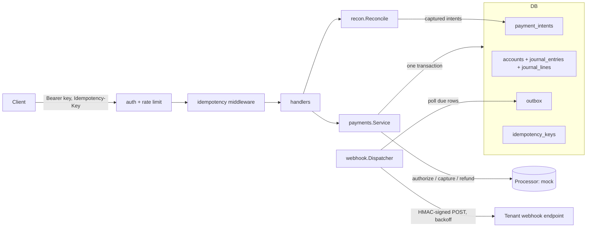

# ledgerline

ledgerline is a small multi-tenant payments API written in Go with only the standard library's
`net/http` and `database/sql`, plus a pure-Go SQLite driver (`modernc.org/sqlite`, no cgo).
It authorizes, captures and refunds card payments against a deterministic mock processor and
records every money movement in a double-entry ledger. The interesting parts are the correctness
mechanics: money is always integer minor units with an ISO 4217 currency, every journal entry must
balance, retried requests are deduplicated with idempotency keys, concurrent refunds can never
exceed the captured amount, and webhooks go through a transactional outbox so an event is written
if and only if the state change commits.

This is a personal learning/portfolio project. It is not deployed anywhere and has no users.

## Features

- **Double-entry ledger**: asset/liability/revenue/expense accounts per tenant and currency; journal
  entries are rejected unless debits equal credits; `int64` minor units with overflow checks and no
  floats; cached balances are updated in the same transaction as the journal lines, and
  `ledger.Verify` recomputes every balance from the lines to prove the cache matches.
- **Payments API**: create (authorize), capture (full or partial), refund (partial or full).
- **Idempotency keys**: the same key and same request replays the stored response (with
  `Idempotent-Replayed: true`); the same key with a different body returns `409`; concurrent
  duplicates wait and then replay; 5xx responses are not stored so clients can retry.
- **Mock card processor** behind a `Processor` interface with test card numbers that
  deterministically approve, decline, report insufficient funds, time out on authorize, or time out
  on capture.
- **Multi-tenant**: API keys are SHA-256 hashed at rest and shown once; every query is scoped by
  `tenant_id`; idempotency keys are per tenant; a token-bucket rate limiter per tenant returns `429`
  with `Retry-After`.
- **Webhooks**: outbox rows are written in the same transaction as the state change; a dispatcher
  claims due events with a lease, retries with capped exponential backoff, dead-letters after
  `MaxAttempts`, and signs payloads with HMAC-SHA256 over `"<timestamp>.<body>"`. `webhook.Verify`
  checks the signature in constant time and rejects stale timestamps.
- **Reconciliation**: `POST /v1/reconciliations` takes a settlement CSV
  (`processor_ref,amount,currency`) and reports matched, missing-from-settlement,
  unknown-in-settlement (including duplicates) and amount/currency mismatches.
- **Load driver**: `cmd/loadgen` reports payments/sec and p50/p95/p99 latency and writes
  `bench/RESULTS.md`.

## Architecture



- **No database transaction is held while the processor is called.** Capture first claims the intent
  (`authorized -> capturing`) in a short transaction, calls the processor, then finalises the
  intent, the ledger entry and the outbox event in a second transaction. Refunds reserve the amount
  the same way and release the reservation if the processor fails. That is what makes the
  "20 concurrent refunds of 300 against a 1000 capture, exactly 3 succeed" test hold.
- **The ledger never takes its own transaction.** `ledger.Post` takes the caller's `*sql.Tx`, so the
  intent update, the journal lines, the cached balances and the webhook event commit or roll back
  together.
- **Idempotency is enforced at the HTTP layer.** The request hash covers method, path and body.
  An in-progress row is committed *before* the handler runs, so a crash mid-request leaves the key
  locked (409) instead of allowing a second charge. In-process duplicates are serialised with
  striped mutexes so they replay rather than fail.
- **SQLite with a single connection.** SQLite allows one writer anyway, and one connection gives
  simple, serialisable behaviour for the balance invariants. It is also the main throughput limit
  (see Results).

## Quickstart

Requires Go 1.27.

```bash
go build -o ledgerline ./cmd/ledgerline
./ledgerline create-tenant -db demo.db -name "Demo Tenant (synthetic)"
# tenant_id=ten_6b64d08dc3f503d69a31ea1e
# api_key=ll_test_80de3d8e...   (shown once; only its SHA-256 hash is stored)
./ledgerline serve -db demo.db -addr 127.0.0.1:8089
```

Real output from a local run (IDs are random; the key above was a throwaway demo key):

```bash
$ curl -s -X POST localhost:8089/v1/payment_intents -H "Authorization: Bearer $KEY" \
    -H "Idempotency-Key: order-1001" \
    -d '{"amount":2500,"currency":"USD","card_number":"4242424242424242"}'
{"id":"pi_ce9292195b5f5e3a5a721645","amount":2500,"currency":"USD","status":"authorized","card_last4":"4242","amount_captured":0,"amount_refunded":0,"created":1793976553}

# same key + different body
{"error":{"code":"idempotency_key_reused","message":"idempotency key was used with a different request"}}

$ curl -s -X POST localhost:8089/v1/payment_intents/pi_ce92.../capture -H "Authorization: Bearer $KEY"
{"id":"pi_ce9292195b5f5e3a5a721645",...,"status":"captured","amount_captured":2500,"capture_ref":"mock_cap_8dc96a_000002",...}

$ curl -s -X POST localhost:8089/v1/payment_intents/pi_ce92.../refunds -H "Authorization: Bearer $KEY" -d '{"amount":500}'
{"id":"pi_ce9292195b5f5e3a5a721645",...,"status":"partially_refunded","amount_captured":2500,"amount_refunded":500,...}

$ curl -s localhost:8089/v1/accounts -H "Authorization: Bearer $KEY"
{"accounts":[{"id":1,"code":"processor_clearing","type":"asset","currency":"USD","balance":2000},
             {"id":3,"code":"refunds","type":"expense","currency":"USD","balance":500},
             {"id":2,"code":"sales_revenue","type":"revenue","currency":"USD","balance":2500}]}

$ curl -s -X POST localhost:8089/v1/reconciliations -H "Authorization: Bearer $KEY" --data-binary \
$'processor_ref,amount,currency\nmock_cap_8dc96a_000002,2400,USD\nmock_cap_unknown_000099,100,USD'
{"matched":0,"missing_from_settlement":[],
 "unknown_in_settlement":[{"processor_ref":"mock_cap_unknown_000099","amount":100,"currency":"USD"}],
 "mismatched":[{"payment_id":"pi_ce9292195b5f5e3a5a721645","processor_ref":"mock_cap_8dc96a_000002",
   "expected_amount":2500,"expected_currency":"USD","settled_amount":2400,"settled_currency":"USD"}]}
```

Routes: `POST /v1/payment_intents`, `GET /v1/payment_intents/{id}`,
`POST /v1/payment_intents/{id}/capture`, `POST /v1/payment_intents/{id}/refunds`,
`GET /v1/accounts`, `PUT /v1/webhook_endpoint` (returns the signing secret),
`POST /v1/reconciliations`, `GET /healthz`.

Test cards: `4242424242424242` approve, `4000000000000002` decline, `4000000000009995`
insufficient funds, `4000000000000119` authorize timeout, `4000000000000259` capture timeout.

Server flags: `-db`, `-addr`, `-rate` (requests/sec per tenant, default 50), `-burst` (default 100).
No environment variables are read.

## Results

Measured 2026-11-06 on a 12th Gen Intel Core i7-12700 (16 logical CPUs), Windows 11 Pro, Go 1.27.3.
Command: `./bench/run.sh` (writes [`bench/RESULTS.md`](bench/RESULTS.md)). Data: 5,000 synthetic
payments generated by `cmd/loadgen` (every 20th card is a decline), 8 concurrent clients, 4 synthetic
tenants, file-backed SQLite in WAL mode, mock processor, in-process server over loopback HTTP. Each
"payment" is an idempotent create plus a capture (two HTTP requests).

| metric | value |
|---|---|
| payments/sec (create+capture) | 946 |
| p50 latency per payment | 6.9 ms |
| p95 latency per payment | 17.63 ms |
| p99 latency per payment | 23.39 ms |
| captured / declined / errors | 4750 / 250 / 0 |
| `ledger.Verify` after the run | passed for all tenants |
| reconciliation of synthetic settlement (matched / missing / mismatched) | 4623 / 95 / 32 (discrepancies are injected on purpose) |

Go micro-benchmarks (`go test -run ^$ -bench . -benchmem -count 3`, in-memory SQLite, range over 3 runs):

| benchmark | ns/op | B/op | allocs/op |
|---|---|---|---|
| `ledger.BenchmarkPost` (2-line entry in its own transaction) | 49,811 - 59,564 | ~3,575 | 108 |
| `api.BenchmarkHTTPCreateAndCapture` (handler path, no network) | 319,102 - 343,105 | ~37,200 | 601 |

The single SQLite connection serialises all work, so throughput is bounded by the database rather
than by HTTP handling; latency percentiles mostly reflect queueing behind that connection.

## Tests / CI

```bash
go vet ./...
go test ./...            # table-driven unit tests + concurrency tests
go test -race ./...      # run in CI on Linux (the race detector needs cgo, unavailable on this Windows machine)
```

Coverage of the important behaviour:

- ledger: entry validation table, normal-balance orientation, cross-tenant and cross-currency
  rejection with rollback, drift detection, and 16 goroutines x 25 concurrent postings followed by `Verify`.
- payments: every test card outcome, partial capture, partial/full refund, over-refund, tenant
  isolation, capture timeout rollback, 20 concurrent refunds (exactly 3 succeed), 10 concurrent
  captures (exactly 1 succeeds).
- api: auth/routing/validation table, idempotent replay and 409, per-tenant key scoping,
  32 concurrent duplicate requests producing one intent and one refund with identical responses,
  rate limiting, reconciliation endpoint.
- webhook: sign/verify table (tamper, wrong secret, stale, future, malformed, key rotation),
  backoff schedule, outbox rollback, retry-then-deliver with signature verification, dead-lettering.
- recon: CSV parsing table and matching edge cases. Tests never touch the network beyond a loopback
  `httptest` server.

`.github/workflows/ci.yml` runs gofmt, `go vet`, `go test -race`, and a benchmark smoke run
(`-benchtime 50x` plus a 300-payment `loadgen`) on Ubuntu with Go 1.27. CI has not been run yet
because the repository has not been pushed.

## Limitations and next steps

- **Mock processor only.** There is no real card network integration. Timeouts are simulated
  instantly; a real system would need to resolve unknown outcomes (query the processor) instead of
  reverting a timed-out capture to `authorized` as this one does.
- **Single-node SQLite.** One connection, one process. The striped idempotency locks are in-process;
  across processes the committed in-progress row returns 409 instead of waiting. A Postgres port
  would use `SELECT ... FOR UPDATE` and a connection pool.
- **Rate limiting is in memory** and resets on restart; it is not shared between instances.
- **Card numbers are passed in plaintext to the mock** (only the last four digits are stored). A
  real system would tokenise cards and stay out of PCI scope.
- **Webhook secrets are stored in plaintext** because they are needed to sign; one endpoint per tenant.
  Delivery is at-least-once, so receivers should dedupe on the event `id`.
- **Reconciliation covers captures only**, not refunds, fees or payouts, and the currency list is a
  small ISO 4217 subset. There is no FX: entries are single-currency.
- **SHA-256 for API keys** is appropriate only because keys are 256-bit random values; it is not a
  password hash.
- Next steps: Postgres backend, refunds and fees in settlement files, API key rotation/revocation,
  and a CLI to replay dead-lettered webhooks.

## License

MIT, see [LICENSE](LICENSE).
